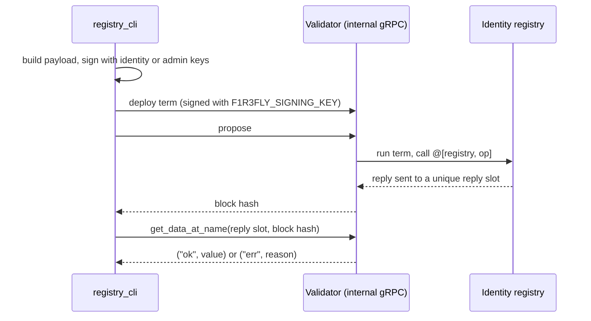

# Identity Registry

The identity registry links secp256k1 keys to stable identity names on a
F1R3FLY shard. A party registers an identity, rotates its key, and reads the
full key history. A quorum of admins can link a new key to an identity whose
current key is lost or compromised.

This repository contains the Rust client library, the `registry_cli` binary,
and the integration tests. The contract itself ships in the genesis block of
f1r3node-rust. Its payloads, operations, and replies are described in
`docs/identity-registry.md` of
<https://github.com/F1R3FLY-io/f1r3node-rust>.
[`DECISIONS.md`](DECISIONS.md) records the design decisions made along the
way.

## How the client calls the contract

The client sends every operation as a deploy, reads included. A read costs
a deploy and a block.



There are two kinds of keys:

- The **deploy key**, `F1R3FLY_SIGNING_KEY`, signs and pays for the deploy.
  It needs a REV balance. It has no authority over any identity.
- The **identity keys and admin keys** sign the payloads. They do not
  necessarily sign a deploy.

The client proposes the block itself. The node must accept a propose
request on its internal gRPC port.

## Using the CLI

### Prerequisites

1. Start a local shard with the 2-of-3 admin quorum:

   ```bash
   make firefly F1R3NODE_DIR=<path to an f1r3node-rust checkout>
   ```

   `F1R3NODE_DIR` defaults to `../f1r3node-rust`. The checkout must contain
   the identity registry contract. This target builds the `f1r3fly-rust:local`
   image from that checkout if the image does not exist. Set
   `F1R3FLY_RUST_IMAGE` to use another image. The target then starts
   `docker/shard.yml` of the checkout with the `docker/quorum.yml` overlay of
   this repository. The admin keys are the bootstrap, validator1, and
   validator2 dev keys from `docker/.env.example` of the checkout.

2. Set a deploy key that has a REV balance on the shard:

   ```bash
   export F1R3FLY_SIGNING_KEY=<32-byte hex secret key>
   ```

Use `make clear-firefly` to stop the shard and remove its data. Do this when
the proposer refuses new blocks because too many blocks are not finalized.

### Global options

| Option | Default | Purpose |
|---|---|---|
| `--node-host` | `127.0.0.1` | Validator host |
| `--grpc-port` | `40422` | Validator internal gRPC port |
| `--registry-uri` (or `IDENTITY_REGISTRY_URI`) | `rho:system:identityRegistry` | Registry to call |

Put global options before the subcommand. All byte values are hex. Secret
keys and names have 32 bytes. Public keys have 65 bytes (uncompressed).

The examples use `cargo run`. Each subcommand also has a Makefile target,
shown below each example.

### keygen

Generate a keypair. This command does not contact the node.

```bash
cargo run --bin registry_cli -- keygen
# sk: <32-byte hex>
# pk: <65-byte hex>
```

`make keygen`

### register

Register an identity. If you omit `--sk` or `--nonce`, the CLI generates a
random value.

```bash
cargo run --bin registry_cli -- register --sk <SK> --nonce <NONCE>
# identity_sk (keep safe): …
# identity_pk:             …
# nonce:                   …
# name:                    <32-byte hex>
```

`make register SK=<SK> NONCE=<NONCE>`

> [!WARNING]
> Keep the secret key, the nonce, and the name. You need the secret key for
> each rotation. You cannot recover the name without the public key and the
> nonce.

### resolve-current

Read the current key, the `seq`, and the registration height.

```bash
cargo run --bin registry_cli -- resolve-current --name <NAME>
# pk:           …
# seq:          0
# block_height: 17
```

`make resolve-current NAME=<NAME>`

### rotate

Link a new key to the identity. The current key and the new key both sign.
`--seq` is the current `seq` from `resolve-current`.

```bash
cargo run --bin registry_cli -- rotate \
  --name <NAME> --current-sk <CURRENT_SK> --new-sk <NEW_SK> --seq 0
# new_seq: 1
```

`make rotate NAME=<NAME> CURRENT_SK=<CURRENT_SK> NEW_SK=<NEW_SK> SEQ=0`

### admin-relink

Link a new key when the current key cannot sign. The call needs signatures
from a quorum of distinct admins, and a signature from the new key. Give the
admin signatures in one of two ways:

- `--admin-sk <ADMIN_SK>`: the CLI signs with the admin key. Repeat the
  option for each admin.
- `--admin-sig <ADMIN_PK>:<SIG>`: a signature that an admin made offline
  with `admin-sign`. Repeat the option for each admin.

You can mix the two forms. `--evidence` is hex bytes, for example the hex of
a ticket reference. The contract stores it as given.

```bash
cargo run --bin registry_cli -- admin-relink \
  --name <NAME> --new-sk <NEW_SK> --seq 1 --evidence <EVIDENCE_HEX> \
  --admin-sk <ADMIN_SK_1> --admin-sk <ADMIN_SK_2>
# new_seq: 2
```

`make admin-relink NAME=<NAME> NEW_SK=<NEW_SK> SEQ=1 EVIDENCE=<EVIDENCE_HEX> ADMIN_SKS="<ADMIN_SK_1> <ADMIN_SK_2>"`

### admin-sign

Make one admin signature offline, so the admin does not share a secret key.
This command does not contact the node and does not read
`F1R3FLY_SIGNING_KEY`. All admins must sign the same `name`, `new-pk`,
`seq`, and `evidence`.

```bash
cargo run --bin registry_cli -- admin-sign \
  --admin-sk <ADMIN_SK> --name <NAME> --new-pk <NEW_PK> --seq 1 --evidence <EVIDENCE_HEX>
# <ADMIN_PK>:<SIG>
```

`make admin-sign ADMIN_SK=<ADMIN_SK> NAME=<NAME> NEW_PK=<NEW_PK> SEQ=1 EVIDENCE=<EVIDENCE_HEX>`

Then give each output line to `admin-relink`:

```bash
cargo run --bin registry_cli -- admin-relink \
  --name <NAME> --new-sk <NEW_SK> --seq 1 --evidence <EVIDENCE_HEX> \
  --admin-sig <ADMIN_PK_1>:<SIG_1> --admin-sig <ADMIN_PK_2>:<SIG_2>
```

`make admin-relink … ADMIN_SIGS="<ADMIN_PK_1>:<SIG_1> <ADMIN_PK_2>:<SIG_2>"`

### resolve-history

Read every key that was linked to the identity, oldest first.

```bash
cargo run --bin registry_cli -- resolve-history --name <NAME>
# entry 0:
#   op:           register
#   seq:          0
#   pk:           …
#   block_height: 17
# entry 1:
#   op:           admin_relink
#   …
#   admin_evidence: …
#   admin_signer: …
```

`make resolve-history NAME=<NAME>`

### Errors

The CLI prints `error: …` and exits with status 1 when an operation fails.

| Message | Cause |
|---|---|
| `F1R3FLY_SIGNING_KEY must be set` | The deploy key is not set. |
| `contract rejected the request: bad_signature` | A signature does not verify, or the admin signatures do not reach the quorum. |
| `contract rejected the request: seq_mismatch` | `--seq` is not the current `seq`. Run `resolve-current`. |
| `contract rejected the request: unknown_name` | The name is not registered. |
| `F1R3FLY node error: propose skipped: …` | The node did not create a block. See `make clear-firefly`. |
| `could not parse contract response: no data at reply slot` | The block has no reply. The deploy can be out of phlo or it can have failed. |

## Tests

| Suite | Command | Needs |
|---|---|---|
| Integration tests | `make test` | A running `make firefly` shard and `F1R3FLY_SIGNING_KEY` |
| RhoSpec suite (`casper/src/test/resources/IdentityRegistryTest.rho` in f1r3node-rust) | `cargo test -p casper --release --test mod identity_registry_spec`, in the f1r3node-rust checkout | Nothing. It runs on a genesis state in memory. |

Both suites check the acceptance criteria REG-AC1 to REG-AC9, except
REG-AC7. Only the integration tests run on a node with real blocks.
